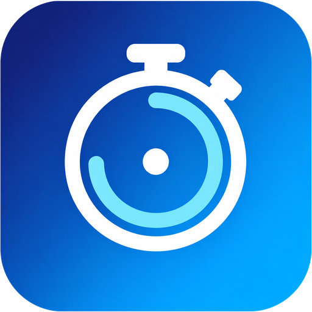

# Simple Timer Card Integration

Server-side timers for Home Assistant, built for the
[Simple Timer Card](https://github.com/eyalgal/simple-timer-card).

The card works on its own. This optional integration adds what a dashboard card
cannot do by itself:

* **Timers that live in Home Assistant.** They keep running with every
  dashboard closed, show the same on every device, and survive restarts.
* **Something happens when a timer ends.** Control any device, say a command
  such as "turn off the air purifier", or announce on any speaker. Home
  Assistant runs it as the user who started the timer.
* **Delayed voice commands as timers.** "Turn off the lights in 10 minutes"
  normally runs hidden inside Home Assistant. With the option on, it shows on
  the card, where you can pause, extend or cancel it. It works in every
  language Assist supports, and Assist answers exactly as before.


## Install

### Marketplace (fka HACS)

[](https://my.home-assistant.io/redirect/hacs_repository/?owner=eyalgal&repository=simple-timer-card-integration&category=integration)

1. In Home Assistant, open **Marketplace (fka HACS)** and search for
   **Simple Timer Card Integration**, or use the button above.
2. Download it and restart Home Assistant.
3. Go to **Settings > Devices & services > Add integration** and pick
   **Simple Timer Card**.

### Manually

Copy `custom_components/simple_timer_card` from the latest release into your
Home Assistant `config/custom_components` folder, restart Home Assistant, then
add **Simple Timer Card** under **Settings > Devices & services**.

The integration creates one entity, `sensor.simple_timer_card_timers`, whose
state is the number of running timers. It needs Home Assistant 2025.6 or later;
the integration icon shows from Home Assistant 2026.3.

## Options

| Option | Default | Description |
| ------ | ------- | ----------- |
| Show delayed voice commands as timers | on | Capture "turn off the lights in 10 minutes" and similar commands. Turn off to leave them to Home Assistant. |
| Run late actions for up to | 10 min | If a timer ended while Home Assistant was stopped, its action still runs at startup when it is no later than this. |

## On the card

Set **Save new timers in** to **Simple Timer Card integration** in the card
editor, or in YAML:

```yaml
type: custom:simple-timer-card
storage: integration
```

The custom timer panel then offers **Do something when it ends**, and pinned
timers get a **When it ends** setting. See the card's
[configuration guide](https://github.com/eyalgal/simple-timer-card/blob/main/CONFIGURATION.md#-companion-integration)
for quick actions, pinned timers and every option.

Coming from MQTT storage? Follow the
[migration guide](https://github.com/eyalgal/simple-timer-card/blob/main/CONFIGURATION.md#-moving-from-mqtt-to-the-integration).

## Actions

The timers entity offers these actions:

| Action | Fields |
| ------ | ------ |
| `simple_timer_card.create_timer` | `duration`, and optionally `name`, `command` or `actions`, `language`, `icon`, `color`, `metadata` |
| `simple_timer_card.pause_timer`, `unpause_timer`, `cancel_timer`, `finish_timer`, `remove_timer` | `timer_id` |
| `simple_timer_card.add_time`, `subtract_time` | `timer_id`, `duration` |
| `simple_timer_card.restart_timer` | `timer_id`, optional `duration` |
| `simple_timer_card.get_timers` | optional `status`; returns the timers |

`simple_timer_card.announce` says a `message` on a speaker (`entity_id`). It
picks the method when it runs: `assist_satellite.announce` on voice
satellites, `notify.alexa_media` on Alexa Media Player speakers, and
`tts.speak` on other media players with the voice of your preferred Assist
pipeline. If that voice is not available, it uses another installed engine,
such as Piper, and skips Home Assistant Cloud without an active subscription.

`cancel_timer` stops a timer without running its action; `finish_timer` runs
it now. Commands need the target entity to be exposed to Assist, as with any
voice command. Actions run as the user who started the timer, so Home
Assistant's permissions apply. Snoozing or finishing someone else's timer
does not change that. If another user finishes it early, the action runs
only if they are allowed to run it too.

## Events

Every change fires a `simple_timer_card_timer` event with `event` (`created`,
`finished`, `cancelled`, ...), `entity_id` and the `timer`:

```yaml
triggers:
  - trigger: event
    event_type: simple_timer_card_timer
    event_data:
      event: finished
conditions:
  - condition: template
    value_template: "{{ trigger.event.data.timer.name == 'Laundry' }}"
actions:
  - action: notify.notify
    data:
      message: Laundry is done
```

## Translations

Strings live in `tools/companion_translations.py`. Run
`python3 tools/companion_translations.py` to regenerate `strings.json` and the
files in `translations/`.

## License

MIT
